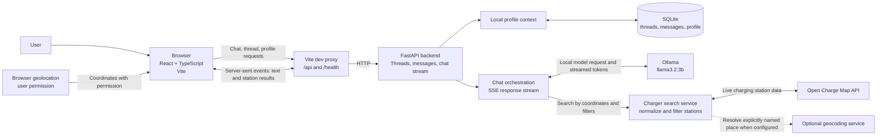

# 1.1 System Architecture

## Request flow

1. The user enters a message in the React frontend. For nearby searches, the browser can provide coordinates after the user grants location permission.
2. The frontend sends chat requests through the Vite `/api` proxy to FastAPI. Chat responses stream back as server-sent events.
3. FastAPI loads the local conversation context from SQLite and sends the conversation to the configured Ollama model.
4. When a live charger lookup is needed, the backend queries Open Charge Map and returns normalized station results to the frontend.
5. FastAPI saves messages and station results in SQLite so they can be shown again in the conversation.

The optional geocoding service can resolve a place explicitly named by the user when configured. The current charger lookup searches around one location; it does not calculate a driving route or find chargers along a route.
